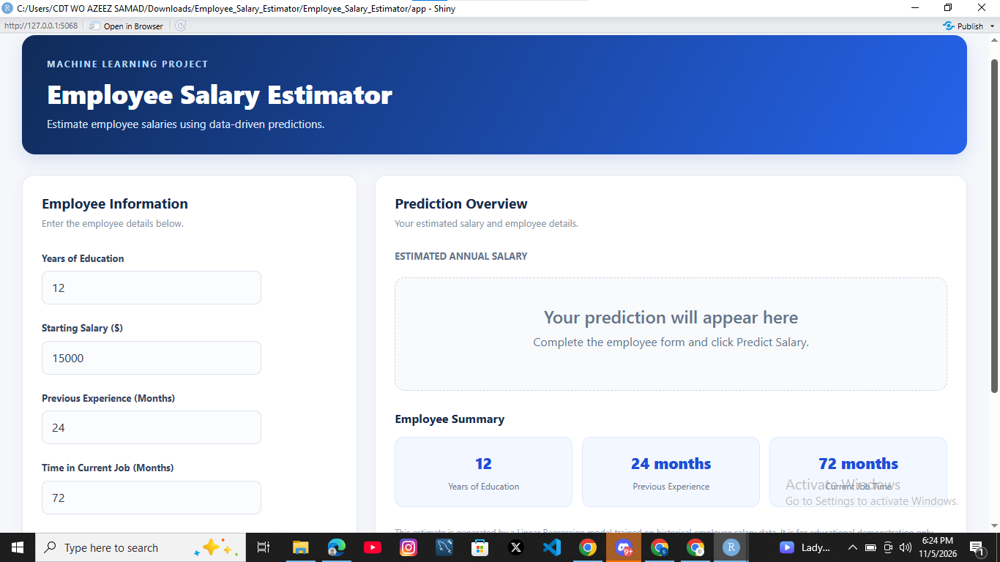
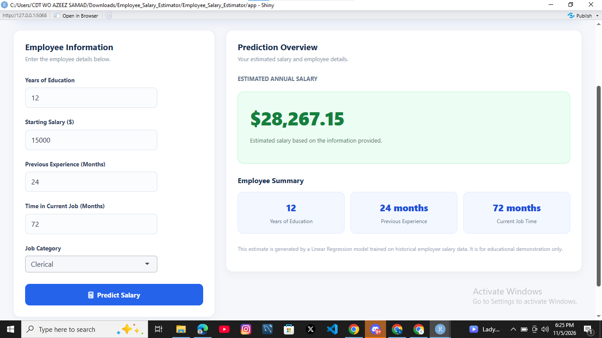

markdown:
wrap: sentence
---

# Employee Salary Estimator

A Machine Learning project built with **R, Multiple Linear Regression, and Shiny** to estimate employee salaries based on selected employment and educational information.

## Project Overview

The Employee Salary Estimator is an interactive web application that predicts an estimated employee salary using a trained Multiple Linear Regression model.

Users can enter employee information, including years of education, starting salary, previous work experience, time in the current job, and job category. The application uses these details to generate a salary prediction.

This project demonstrates the complete machine learning workflow, from data exploration and preprocessing to model training, evaluation, and deployment preparation.

## Application Preview

The application provides: - An interactive employee information form. - A salary prediction dashboard. - An estimated annual salary display. - An employee information summary.

## Technologies Used

| Technology        | Purpose                                |
|-------------------|----------------------------------------|
| R                 | Programming language                   |
| RStudio           | Development environment                |
| Shiny             | Interactive web application            |
| bslib             | Dashboard styling and theming          |
| ggplot2           | Data visualization                     |
| dplyr             | Data manipulation                      |
| caret             | Training and testing data partitioning |
| Linear Regression | Salary prediction algorithm            |

## Dataset

The project uses the `employee` dataset from the R package `stima`.

**Dataset information:** - Total observations: 473 employees. - Total original variables: 9. - Target variable: `salary`. - Selected predictors: `edu`, `startsal`, `prevexp`, `jobtime`, and `jobcat`.

The dataset contains historical employee salary information from the United States. It is used for educational and machine learning demonstration purposes.

## Machine Learning Methodology

The project follows these steps:

1.  **Data Collection:** Obtained the employee dataset from the `stima` R package.
2.  **Data Exploration:** Examined dataset structure, variables, distributions, and summary statistics.
3.  **Data Cleaning:** Checked for missing values and duplicate records.
4.  **Exploratory Data Analysis:** Used visualizations to investigate relationships between employee characteristics and salary.
5.  **Correlation Analysis:** Examined relationships between numerical variables.
6.  **Feature Selection:** Selected five predictors for the model.
7.  **Train-Test Split:** Divided the dataset into training and testing subsets using an 80:20 split.
8.  **Model Training:** Developed a Multiple Linear Regression model using R's `lm()` function.
9.  **Prediction:** Generated salary predictions using the testing dataset.
10. **Model Evaluation:** Evaluated the model using MAE, RMSE, and R-squared.
11. **Application Development:** Integrated the trained model into an interactive Shiny application.

## Model Performance

The model was evaluated using the test dataset.

| Evaluation Metric              |           Score |
|--------------------------------|----------------:|
| Mean Absolute Error (MAE)      |       4,216.687 |
| Root Mean Squared Error (RMSE) |       5,802.533 |
| Test R-squared                 | 0.8055 (80.55%) |

**Interpretation:**

-   **MAE:** The model's predictions differ from actual salaries by approximately \$4,216.69 on average.
-   **RMSE:** The model's root mean squared prediction error is approximately \$5,802.53.
-   **Test R-squared:** The model explains approximately 80.55% of the variation in salaries in the test dataset.

These results describe performance on this particular historical dataset and do not guarantee accuracy on other populations or current salary data.

## Project Structure

``` text
Employee_Salary_Estimator/
│
├── app/
│   └── app.R
│
├── data/
│   └── employee_salary.csv
│
├── scripts/
│   └── 02_explore_dataset.R
│
├── plots/
│   └── actual_vs_predicted.png
│
├── models/
│   └── salary_model.rds
│
├── README.md
│
└── Employee_Salary_Estimator.Rproj
```

## Installation and Setup

### 1. Clone the repository

``` bash
git clone https://github.com/samad-source/Employee-Salary-Estimator.git
```

### 2. Open the project

Open `Employee_Salary_Estimator.Rproj` in RStudio.

### 3. Install the required packages

Run the following commands in the RStudio console:

``` r
install.packages("shiny")
install.packages("bslib")
install.packages("ggplot2")
install.packages("dplyr")
install.packages("caret")
install.packages("readr")
```

### 4. Run the application

From the project root directory, execute:

``` r
shiny::runApp("app")
```

The Shiny application will open in your default browser or RStudio viewer.

## How to Use the Application

1.  Open the Employee Salary Estimator application.

2.  Enter the employee's years of education.

3.  Enter the starting salary.

4.  Enter previous work experience in months.

5.  Enter time spent in the current job in months.

6.  Select the employee's job category.

7.  Click **Predict Salary**.

8.  View the estimated annual salary.

    



## Future Improvements

Possible future improvements include:

-   Deploying the application online.
-   Improving the user interface.
-   Testing additional regression algorithms.
-   Adding more recent and representative salary data.
-   Comparing multiple machine learning models.
-   Improving prediction reliability through further validation.

## Important Disclaimer

This project is an educational machine learning demonstration. It uses historical United States employee salary data and should not be used to determine actual employee compensation, hiring decisions, or current market salaries.

## Author

Samad Azeez(Unscripted)

**Project:** Employee Salary Estimator\
**Programming Language:** R\
**Model:** Multiple Linear Regression\
**Application Framework:** Shiny
